# Mermaid diagram types

Every diagram type that is checked manually. Open with `cargo run -- examples/mermaid.md`.

## flowchart

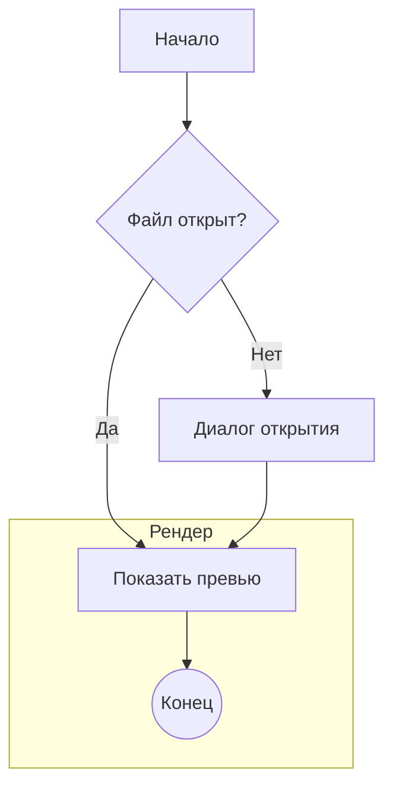

## sequence

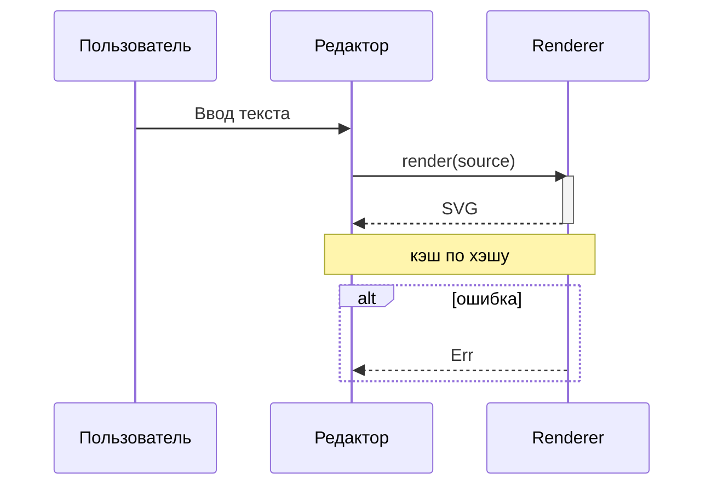

## class

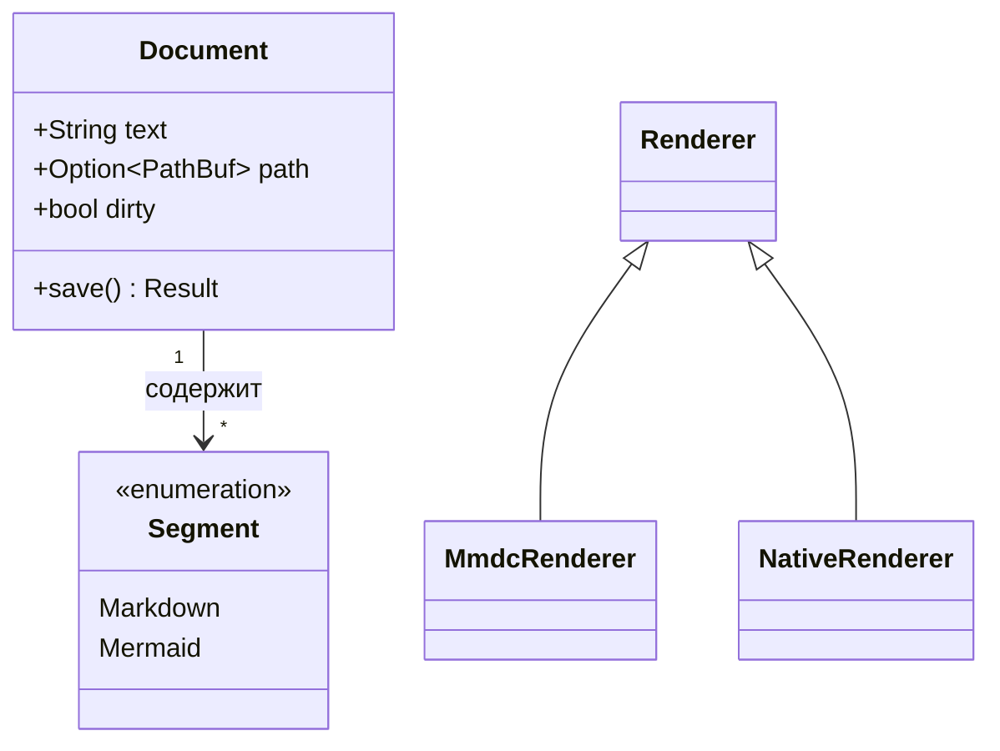

## state

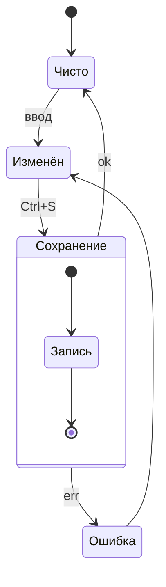

## er

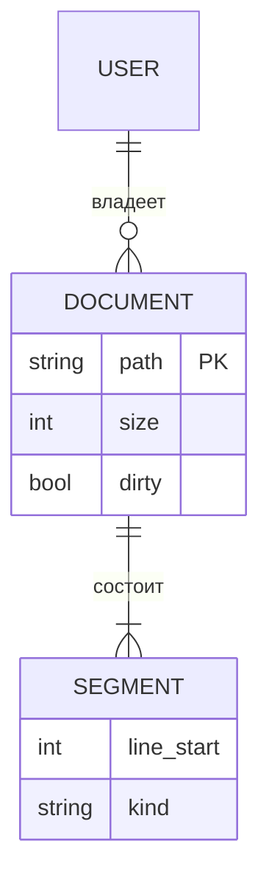

## gantt

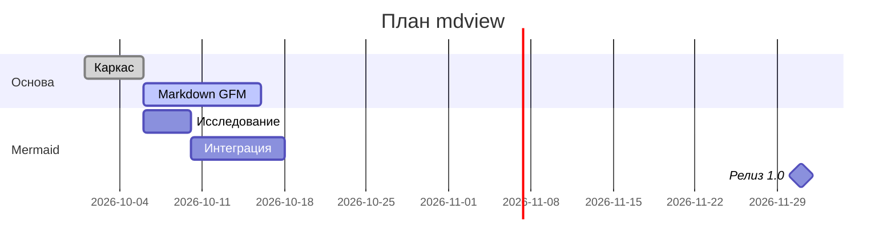

## pie

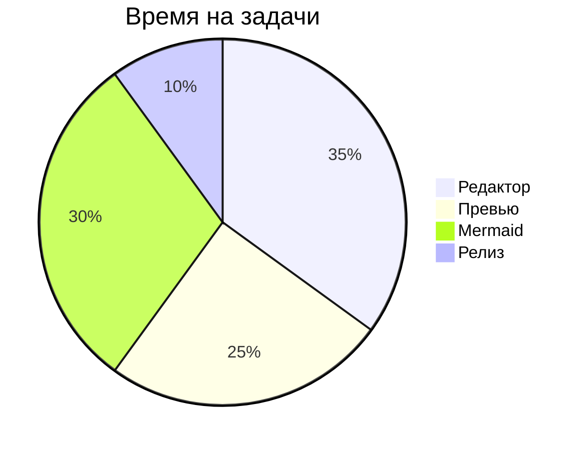

## mindmap

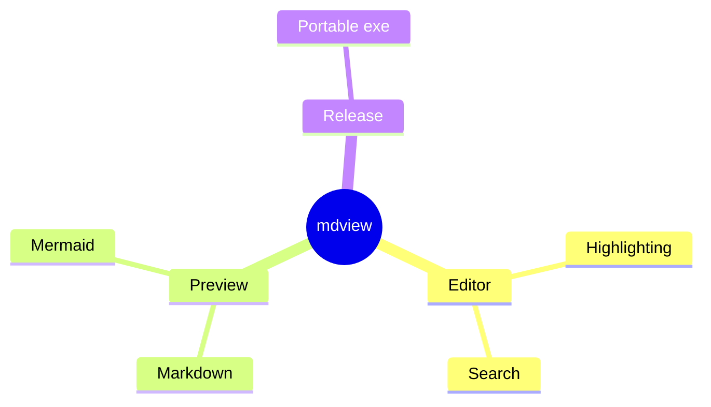

## timeline

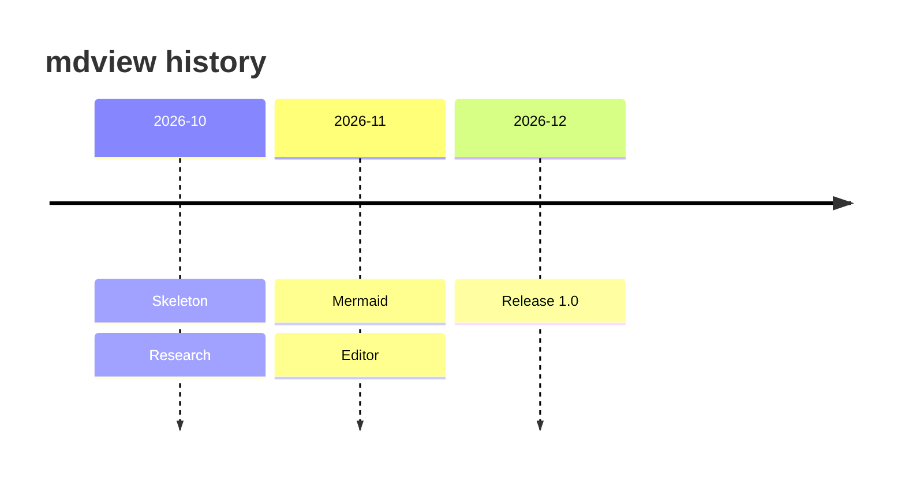

## gitGraph

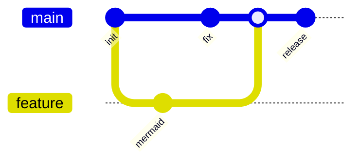

## journey

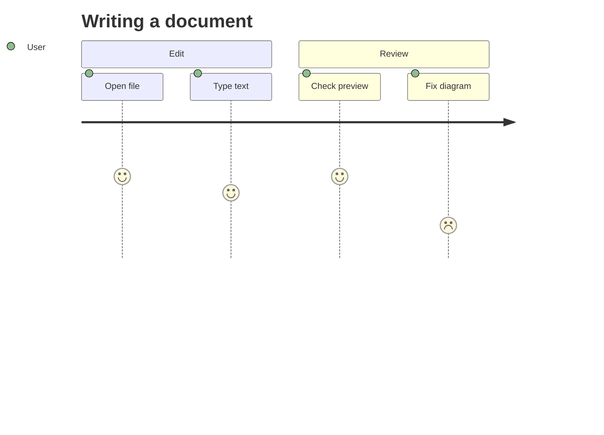

## Syntax error (must show a message, not crash)

```mermaid
flowchart TD
    A[Unclosed --> B
```
