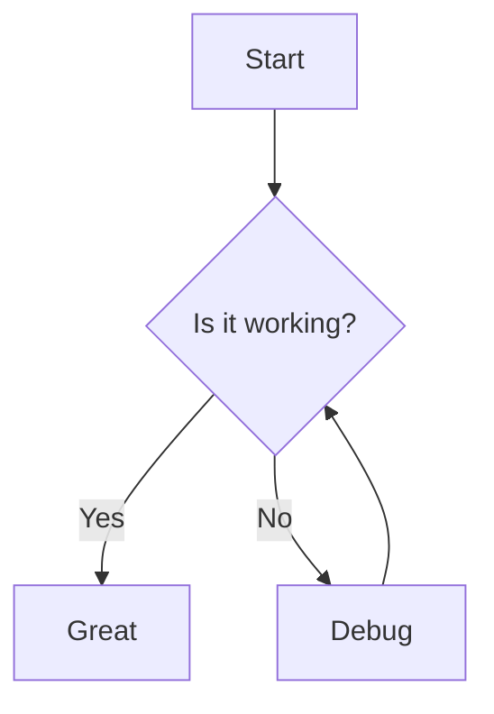
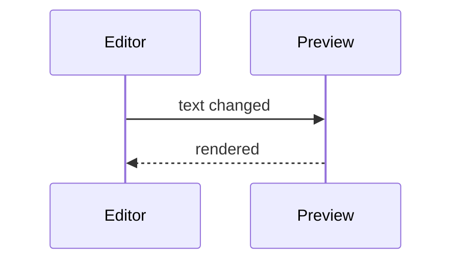
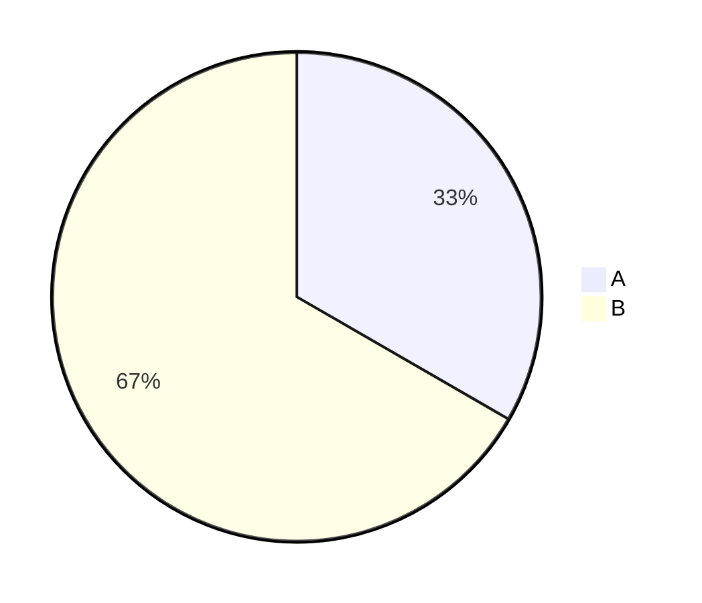

# Showcase: all supported Markdown elements

Every element Markdowntown can show, on one page. Open this file in Markdowntown
(File → Open or drop it on the window) and compare the source with the preview;
from the source tree: `cargo run -- examples/showcase.md`.

## Headings

# H1
## H2
### H3
#### H4
##### H5
###### H6

## Inline formatting

Plain text, **bold**, *italic*, ***bold italic***, ~~strikethrough~~, `inline code`,
and a [link to CommonMark](https://commonmark.org). Autolink: <https://github.com>.

Кириллица: **жирный**, *курсив*, `код`, ~~зачёркнутый~~.

Line with a hard break at the end  
and the next line.

## Lists

- Unordered item
- Another item
  - Nested item
    - Deeper nested item
- Back to the first level

1. Ordered item
2. Second item
   1. Nested ordered
   2. Another nested
3. Third item

### Task list

- [x] Done task
- [ ] Open task (click the checkbox in the preview — the source must change)
- [ ] Another open task

## Blockquotes

> A simple quote.
>
> > Nested quote.

## Alerts (GFM)

> [!NOTE]
> Useful information.

> [!TIP]
> A helpful hint.

> [!IMPORTANT]
> Key information.

> [!WARNING]
> Needs attention.

> [!CAUTION]
> Possible negative consequences.

## Code

```rust
use std::collections::HashMap;

fn main() {
    let mut counts: HashMap<&str, usize> = HashMap::new();
    for word in "a b a c b a".split_whitespace() {
        *counts.entry(word).or_default() += 1;
    }
    println!("{counts:?}");
}
```

```python
def greet(name: str) -> str:
    return f"Привет, {name}!"
```

```
Code block without a language.
```

## Tables

| Left | Center | Right |
|:-----|:------:|------:|
| a    | b      | 1     |
| long cell | **bold** | 22 |
| `code` | кириллица | 333 |

Blocks inside list items (spacing as on GitHub):

1. First paragraph of the item.

   Second paragraph of the same item.

   ```
   code inside the item
   ```

   > A quote inside the item.
2. Options to check:

   | Group | Option | Value |
   | --- | --- | --- |
   | Remove Tracks | Except Bone Transform | yes |
   | Bone Renamer | Unique Node (Make Unique) | yes, skeleton name `GeneralSkeleton` |

   Text after the table in the same item.
2. Next item.

## Horizontal rule

Above the rule.

---

Below the rule.

## Footnotes

Text with a footnote[^1] and another one[^note].

[^1]: The first footnote.
[^note]: A named footnote.

## Definition list

Term
: Definition of the term.

## Math

Inline: the area of a circle is $S = \pi r^2$, and $e^{i\pi} + 1 = 0$ in the middle of a line.

Display:

$$
\int_0^1 x^2\,dx = \frac{1}{3}, \qquad \sum_{k=1}^{n} k = \frac{n(n+1)}{2}
$$

$$
\begin{pmatrix} a & b \\ c & d \end{pmatrix}^{-1}
= \frac{1}{ad - bc} \begin{pmatrix} d & -b \\ -c & a \end{pmatrix}
$$

Prices are not formulas: it costs $5 and $10. An error is shown as source: $\frac{1}$.

## Images

Local SVG (path relative to this file):


Remote image:


## Mermaid

All diagram types are in [mermaid.md](mermaid.md).



Text between two diagrams.



A diagram right after a list:

- Item



The end.
